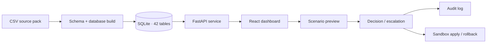

<div align="center">

# 🏥 Hospital Digital Twin

### ZAWolf · A transparent, scenario-based hospital operations prototype

Explore operational data, review agent recommendations, and compare safe what-if scenarios through an English and Arabic interface.

<p>
  
  
  
  
  
</p>

**An auditable engineering demo — not a live hospital system or a clinically validated decision aid.**

[Quick start](#-quick-start) · [What it does](#-what-it-does) · [Roles](#-roles--permissions) · [Project guide](#-project-guide)

</div>

---

## 🌐 At a glance

| | |
|---|---|
| **Purpose** | Hospital operations exploration, transparent agent recommendations, and bounded scenario simulation |
| **Data** | Synthetic, CSV-backed dataset · 42 tables · 678,013 rows in the generated SQLite database |
| **Backend** | Python 3.13 · FastAPI · Uvicorn · SQLite |
| **Frontend** | React · TypeScript · Vite · English and Arabic/RTL |
| **Safety approach** | Role-based access, audit trail, approval revalidation, fail-closed constraints, sandbox apply/rollback |
| **Current state** | Phases 0–6 and platform work in Phases 7–8 are implemented; see the [verification record](docs/STATUS.md) |

## ✨ What it does

- **Operational views:** overview, beds and capacity, staff, operating rooms, forecasts, alerts, decisions, and audit history.
- **Agent recommendations:** show evidence and abstain when a demand baseline or validated model is missing.
- **Scenario Lab:** preview bounded interventions against an `as_of` snapshot, compare before/after values, inspect assumptions and warnings, and save drafts for review.
- **Safe decision workflow:** separate `NO_ACTION` from `ESCALATE`; escalations show the residual and require a manager acknowledgement note. They cannot be approved or applied.
- **Sandbox:** eligible approved actions can be applied and rolled back with the decision lifecycle recorded for review.
- **Bilingual interface:** English and Arabic layouts, including RTL behavior, sourced from the maintained UI in `lovable_src/`.

### Scenario and forecast limits

ICU/WARD bed and nurse agents **abstain** because their candidate models did not beat the weekday-mean baseline. Scenario estimates may use that baseline only with the label **“assumption: unvalidated baseline forecast.”** Doctor and resource demand agents abstain because matching demand baselines are not present. ER arrivals/wait and OR utilization passed their recorded backtest; this does not validate clinical use.

The source pack has roster headcounts but no case-level OR team/provider assignments. OR moves that require an unverifiable team therefore fail closed. Added beds remain assumptions unless staffing and equipment can be verified. See [data reconciliation](docs/RECONCILIATION.md), [data changes](docs/DATA_CHANGES.md), and the [forecast/RAG notes](docs/RAG_EVAL.md).

## 🧭 How the project fits together



The React source lives in `lovable_src/hdt-ui`; the packaging script builds the static app in `ui/`, which FastAPI serves at `/`. The backend domain and agent implementation is in `hospital_agents/`; schema and data build tools are in `db/`.

## 👥 Roles & permissions

Permissions are enforced by the server and covered by real requests against routes discovered from the OpenAPI schema. The full route-by-role status table is in [`docs/ROLE_MATRIX.md`](docs/ROLE_MATRIX.md).

| Role | Read | Preview scenarios | Run agents | Save drafts | Approve / reject / rollback | Edit policies |
|---|:---:|:---:|:---:|:---:|:---:|:---:|
| `viewer` | ✅ | — | — | — | — | — |
| `clinician` | ✅ | ✅ | — | ✅ | — | — |
| `analyst` | ✅ | ✅ | ✅ | ✅ | — | — |
| `operations_manager` | ✅ | ✅ | ✅ | ✅ | ✅ | ✅ |

Local accounts are bootstrapped on first run. Set local credentials in an ignored `.env` file using the `HDT_*_PASSWORD` variables; the clinician credential can be generated automatically or set explicitly. Never commit `.env`.

## 🚀 Quick start

### Windows · PowerShell

From the repository root, install the pinned Python dependencies, build the database and reports, then start the app:

```powershell
py -3.13 -m pip install -r requirements.txt
Copy-Item .env.example .env
py -3.13 -m db.generate_schema
py -3.13 -m db.build_db
py -3.13 -m db.evaluate_forecasts
py -3.13 -m db.validate_data
py -3.13 app.py
```

Open **http://127.0.0.1:8000**. First-run credentials are printed once to the server terminal. Interactive API docs are available at **http://127.0.0.1:8000/docs**.

To rebuild the dashboard from its source, open a second PowerShell window:

```powershell
cd lovable_src\hdt-ui
npm install
npm test
npm run build
node scripts/package_app_py.mjs ..\..\ui
```

Restart the Python server to serve the rebuilt `ui/` assets. Node 24.21.0 completed this package build in the recorded environment; the current build output and per-file backend test results are summarized in [`docs/STATUS.md`](docs/STATUS.md).

### Run checks

```powershell
# From the repository root: each tests/*.py file runs in its own process
py -3.13 scripts/run_tests.py

# From lovable_src\hdt-ui
npm test
```

## 📚 Project guide

| Path | Contents |
|---|---|
| `app.py` | FastAPI entry point and HTTP routes |
| `hospital_agents/` | Agent and application service logic |
| `db/` | Generated schema, data build, evaluation, and validation tools |
| `data/` · `data_contracts/` | Source dataset and table contracts |
| `runtime/` | Local generated database and persisted session state (ignored by Git) |
| `lovable_src/hdt-ui/` | Editable frontend source and UI tests |
| `ui/` | Packaged frontend served by the application |
| `tests/` | Backend, API contract, role, safety, and scenario tests |
| `docs/` | Status, data caveats, reconciliation, role matrix, and evaluation notes |

## 🔎 Verification and limits

- The latest recorded per-file backend run passed. `test_browser.py` skips because Playwright/Chromium is unavailable; a legacy frontend harness case also skips.
- The Lovable UI suite recorded **40 passing tests** across six Vitest files. API response-key checks are covered by `tests/test_contract_keys.py` and `tests/contract_keys.json`.
- **Not verified:** browser rendering, Docker build/run, GitHub Actions CI after the latest fixes, Python 3.12 behavior, and clinical validity. The recorded runtime is Python 3.13 on Windows.
- Dataset values are synthetic. Reports, forecasts, and scenario outputs do not represent real hospital outcomes and must not be used for patient care or operational decisions.

For the detailed phase history, per-file timings, remaining gaps, and measured resource/latency figures, see [`docs/STATUS.md`](docs/STATUS.md).

---

<div align="center">
Built as an auditable hospital operations prototype · English + العربية · Synthetic data only
</div>
