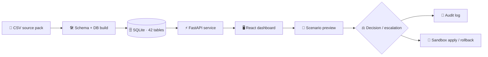
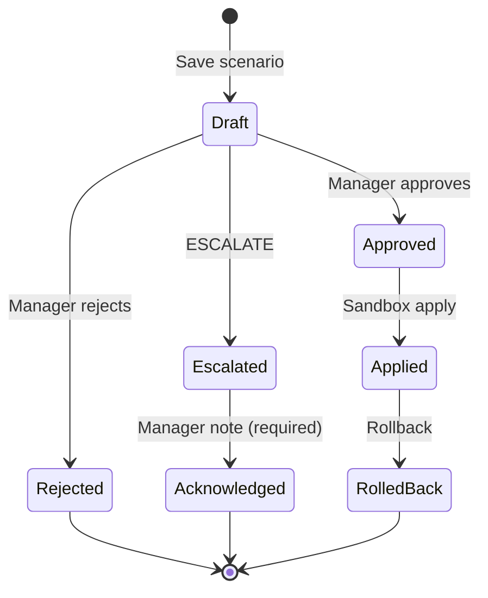

<div align="center">


<a href="#-features"></a>

**Observe → Analyze → Simulate → Decide**

Explore operational hospital data, run transparent what-if scenarios, and route every decision through an auditable, role-enforced workflow — in **English** or **العربية**.

<p>
  
  
  
  
  
  
  
</p>

<table>
  <tr>
    <td align="center"><h3>42</h3>CSV-backed tables</td>
    <td align="center"><h3>678,013</h3>synthetic rows</td>
    <td align="center"><h3>4</h3>server-enforced roles</td>
    <td align="center"><h3>40</h3>passing UI tests</td>
    <td align="center"><h3>EN · ع</h3>bilingual + RTL</td>
  </tr>
</table>

[🚀 Quick start](#-quick-start) · [✨ Features](#-features) · [🧭 Architecture](#-architecture) · [👥 Roles](#-roles--permissions) · [🧪 Testing](#-testing) · [📚 Project guide](#-project-guide) · [⚠️ Limits](#️-verification--limits)

> [!WARNING]
> **Synthetic-data engineering prototype.** This is not a live hospital system and not a clinically validated decision aid. Never use its outputs for patient care or real operational decisions.

</div>

---

## 📑 Table of contents

- [✨ Features](#-features)
- [🛡️ Safety by design](#️-safety-by-design)
- [🧭 Architecture](#-architecture)
- [🔄 Decision lifecycle](#-decision-lifecycle)
- [👥 Roles & permissions](#-roles--permissions)
- [🚀 Quick start](#-quick-start)
- [⚙️ Configuration](#️-configuration)
- [🧪 Testing](#-testing)
- [📚 Project guide](#-project-guide)
- [⚠️ Verification & limits](#️-verification--limits)
- [📖 Further documentation](#-further-documentation)
- [🇸🇦 ملخص بالعربية](#-ملخص-بالعربية)

---

## ✨ Features

| Area | What you get |
|---|---|
| 📊 **Operational views** | Overview, beds & capacity, staff, operating rooms, forecasts, alerts, decisions, and full audit history. |
| 🤖 **Agent recommendations** | Every recommendation shows its evidence — and agents **abstain** when a demand baseline or validated model is missing. |
| 🧪 **Scenario Lab** | Preview bounded interventions against an `as_of` snapshot, compare before/after values, inspect assumptions & warnings, save drafts for review. |
| ✅ **Safe decision workflow** | `NO_ACTION` is kept separate from `ESCALATE`. Escalations show the residual and require a manager acknowledgement note — they can never be approved or applied. |
| 🧰 **Sandbox** | Eligible approved actions can be applied and rolled back, with the full lifecycle recorded. |
| 🌍 **Bilingual UI** | English and Arabic layouts with proper RTL behavior, from the maintained source in `lovable_src/`. |
| 🔐 **Server-enforced RBAC** | Permissions checked on the server and tested with real requests against every OpenAPI route. |
| 📜 **Audit trail** | Every decision, escalation, apply, and rollback is logged for review. |

---

## 🛡️ Safety by design

The system prefers **saying "I don't know"** over a confident wrong answer.

| Agent / model | Status | Behavior |
|---|:---:|---|
| ER arrivals / wait | ✅ Passed backtest | Forecasts shown (not clinically validated) |
| OR utilization | ✅ Passed backtest | Forecasts shown (not clinically validated) |
| ICU / WARD beds & nurses | ⛔ Abstains | Models did not beat the weekday-mean baseline |
| Doctor & resource demand | ⛔ Abstains | No matching demand baseline available |

- Scenario estimates may use the weekday-mean baseline **only** when labelled **“assumption: unvalidated baseline forecast.”**
- The source pack has roster headcounts but **no case-level OR team/provider assignments** — OR moves that need an unverifiable team **fail closed**.
- Added beds remain **assumptions** unless staffing and equipment can be verified.

📎 Details: [Data reconciliation](docs/RECONCILIATION.md) · [Data changes](docs/DATA_CHANGES.md) · [Forecast / RAG notes](docs/RAG_EVAL.md)

---

## 🧭 Architecture



| Layer | Location | Notes |
|---|---|---|
| Frontend source | `lovable_src/hdt-ui` | React + TypeScript, Vitest |
| Packaged UI | `ui/` | Static build served by FastAPI at `/` |
| API | `app.py` | FastAPI routes, OpenAPI at `/docs` |
| Domain & agents | `hospital_agents/` | Agent and service logic |
| Data tooling | `db/` | Schema generation, build, evaluation, validation |

---

## 🔄 Decision lifecycle



> Escalations can be **acknowledged only** — never approved or applied.

---

## 👥 Roles & permissions

| Role | Read | Preview scenarios | Run agents | Save drafts | Approve / reject / rollback | Edit policies |
|---|:---:|:---:|:---:|:---:|:---:|:---:|
| `viewer` | ✅ | — | — | — | — | — |
| `clinician` | ✅ | ✅ | — | ✅ | — | — |
| `analyst` | ✅ | ✅ | ✅ | ✅ | — | — |
| `operations_manager` | ✅ | ✅ | ✅ | ✅ | ✅ | ✅ |

Full route-by-role matrix: [`docs/ROLE_MATRIX.md`](docs/ROLE_MATRIX.md)

---

## 🚀 Quick start

### Prerequisites

- **Python 3.13** (recorded runtime: Windows)
- **Node.js 24.21.0** (only to rebuild the dashboard)

### 1 · Backend & database (PowerShell)

```powershell
py -3.13 -m pip install -r requirements.txt
Copy-Item .env.example .env
py -3.13 -m db.generate_schema
py -3.13 -m db.build_db
py -3.13 -m db.evaluate_forecasts
py -3.13 -m db.validate_data
py -3.13 app.py
```

| URL | What |
|---|---|
| http://127.0.0.1:8000 | Dashboard |
| http://127.0.0.1:8000/docs | Interactive API docs |

> [!NOTE]
> First-run credentials are printed **once** to the server terminal.

### 2 · Rebuild the dashboard (optional)

```powershell
cd lovable_src\hdt-ui
npm install
npm test
npm run build
node scripts/package_app_py.mjs ..\..\ui
```

Restart the Python server to serve the rebuilt `ui/` assets.

<details>
<summary>🐧 macOS / Linux equivalent</summary>

```bash
python3.13 -m pip install -r requirements.txt
cp .env.example .env
python3.13 -m db.generate_schema
python3.13 -m db.build_db
python3.13 -m db.evaluate_forecasts
python3.13 -m db.validate_data
python3.13 app.py
```

> Not verified in the recorded environment.
</details>

---

## ⚙️ Configuration

Local accounts are bootstrapped on first run. Configure them in an ignored `.env` file:

| Variable | Purpose |
|---|---|
| `HDT_*_PASSWORD` | Password per local role account |
| Clinician credential | Auto-generated, or set explicitly |

> [!CAUTION]
> Never commit `.env`.

---

## 🧪 Testing

```powershell
# Backend — each tests/*.py runs in its own process (repo root)
py -3.13 scripts/run_tests.py

# Frontend — from lovable_src\hdt-ui
npm test
```

| Suite | Result |
|---|---|
| Backend (per-file) | ✅ Passed — `test_browser.py` skipped (no Playwright/Chromium), one legacy harness case skipped |
| Frontend (Vitest) | ✅ **40 tests** across 6 files |
| API contract keys | ✅ `tests/test_contract_keys.py` + `tests/contract_keys.json` |
| Role enforcement | ✅ Real requests against OpenAPI-discovered routes |

---

## 📚 Project guide

```text
.
├── app.py                 # FastAPI entry point & HTTP routes
├── hospital_agents/       # Agent & application service logic
├── db/                    # Schema, build, evaluation & validation tools
├── data/                  # Synthetic source dataset
├── data_contracts/        # Table contracts
├── runtime/               # Local DB & session state (git-ignored)
├── lovable_src/hdt-ui/    # Editable frontend source & UI tests
├── ui/                    # Packaged frontend served by the app
├── tests/                 # Backend, API contract, role, safety & scenario tests
├── scripts/               # Test runner & helpers
└── docs/                  # Status, caveats, reconciliation, role matrix, evaluations
```

---

## ⚠️ Verification & limits

**✅ Verified:** per-file backend tests · 40 UI tests · API contract keys · role enforcement · Python 3.13 on Windows

**❓ Not verified:**
- Browser rendering
- Docker build / run
- GitHub Actions CI after the latest fixes
- Python 3.12 behavior
- Clinical validity

> [!IMPORTANT]
> All dataset values are **synthetic**. Reports, forecasts, and scenario outputs do not represent real hospital outcomes.

Phase history, per-file timings, remaining gaps, and resource/latency figures: [`docs/STATUS.md`](docs/STATUS.md)

---

## 📖 Further documentation

| Document | Contents |
|---|---|
| [`docs/STATUS.md`](docs/STATUS.md) | Build output, test results, timings, gaps |
| [`docs/ROLE_MATRIX.md`](docs/ROLE_MATRIX.md) | Route-by-role permission table |
| [`docs/RECONCILIATION.md`](docs/RECONCILIATION.md) | Data reconciliation |
| [`docs/DATA_CHANGES.md`](docs/DATA_CHANGES.md) | Data changes log |
| [`docs/RAG_EVAL.md`](docs/RAG_EVAL.md) | Forecast & RAG evaluation notes |

---

## 🇸🇦 ملخص بالعربية

<div dir="rtl">

**التوأم الرقمي للمستشفى** نموذج أولي لاستكشاف بيانات تشغيل المستشفى ومحاكاة سيناريوهات "ماذا لو" بشفافية، مع سير قرارات آمن وقابل للتدقيق.

- 📊 لوحات للأسرّة، الطاقم، غرف العمليات، التنبؤات، التنبيهات والقرارات.
- 🤖 وكلاء يعرضون الأدلة ويمتنعون عن التوصية عند غياب نموذج موثوق.
- 🧪 مختبر سيناريوهات بمقارنة قبل/بعد وحفظ مسودات.
- 🔐 أربعة أدوار تُفرض صلاحياتها من الخادم.
- 🌍 واجهة بالعربية والإنجليزية مع دعم كامل لاتجاه RTL.

> ⚠️ البيانات اصطناعية بالكامل، ولا يجوز استخدام النتائج في رعاية المرضى أو قرارات تشغيلية حقيقية.

</div>

---

<div align="center">

**Built as an auditable hospital operations prototype**
English + العربية · Synthetic data only

<sub>Made with ❤️ by ZAWolf</sub>


</div>
